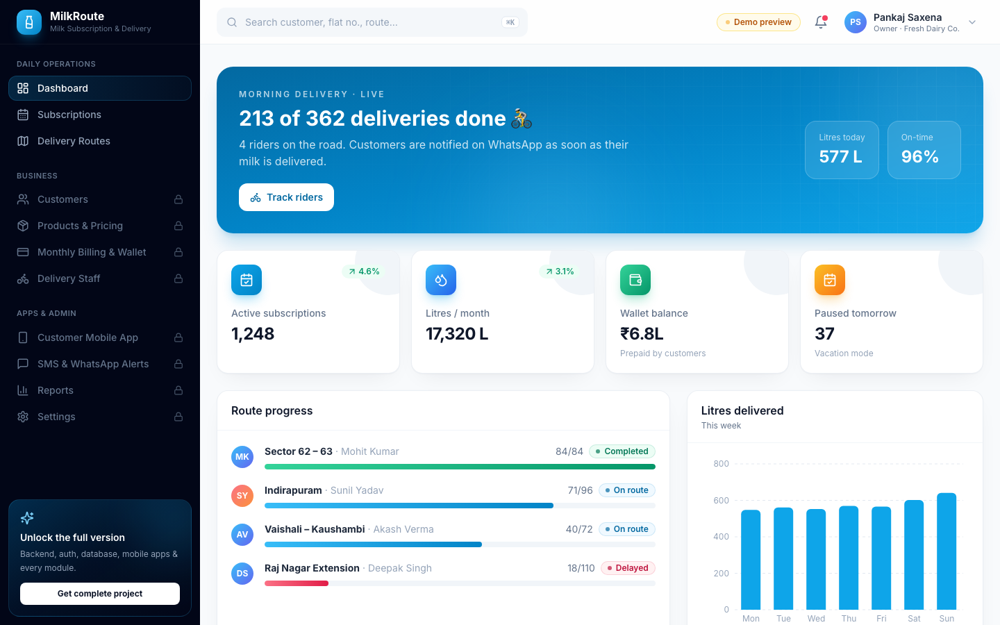
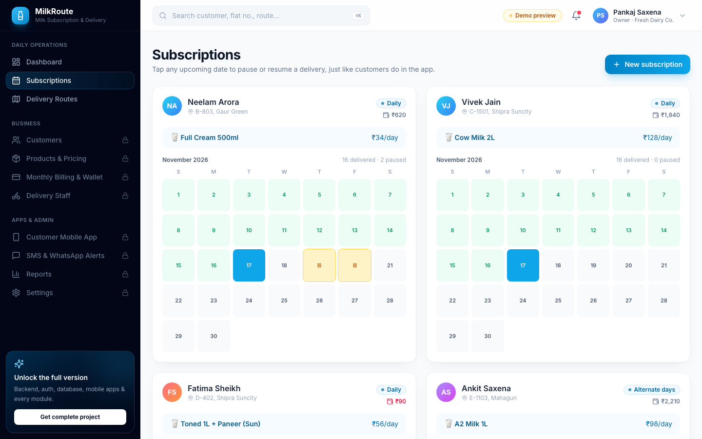
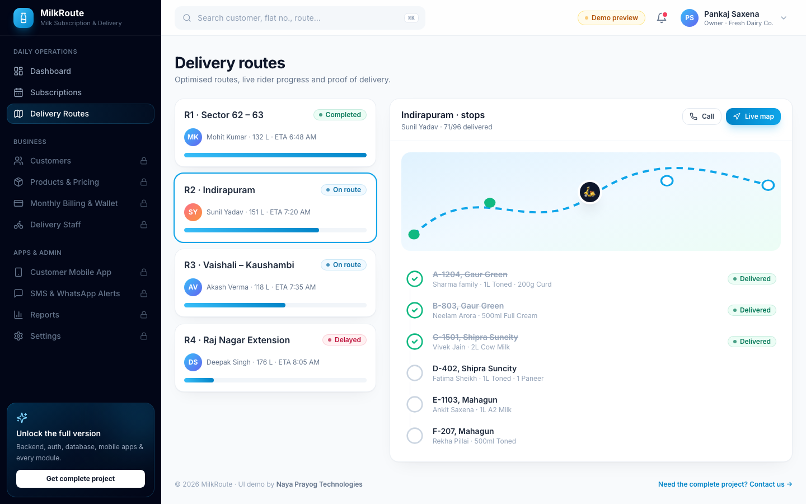

For `milk-delivery-management-software`, we'll target dairy businesses that supply milk directly to households, shops, hotels, restaurants, and other customers.

This repository should have a different SEO focus from `dairy-management-software`:

- **Dairy Management Software:** Milk collection, farmers, fat/SNF, procurement and dairy operations.
- **Milk Delivery Management Software:** Customer subscriptions, recurring orders, delivery routes, delivery staff, daily dispatch, invoices and payments.

The second category is particularly relevant to local milk suppliers and subscription-based dairy businesses.

## **1. GitHub README**

# Milk Delivery Management Software | Milk Subscription, Billing & Delivery System

Simplify daily milk distribution with custom **Milk Delivery Management Software** developed by **Naya Prayog Technologies**.

We provide milk delivery software development services for dairy businesses, local milk suppliers, dairy distributors, subscription-based milk delivery startups, and businesses delivering milk and dairy products directly to customers.

A modern milk delivery management system can help businesses manage customer subscriptions, recurring orders, daily delivery schedules, delivery routes, delivery staff, billing, payments, and customer accounts from a centralized platform.

Whether you operate a local milk delivery business or manage a large dairy distribution network, we can develop a solution tailored to your business model.

**Looking for Milk Delivery Management Software Development?**

Let's discuss your project.

- Website: [https://nayaprayog.com/](https://nayaprayog.com/)
- Email: [support@nayaprayog.com](mailto:support@nayaprayog.com)
- Phone / WhatsApp: +91 7991327022
- Direct WhatsApp: [https://wa.me/917991327022](https://wa.me/917991327022)
- Portfolio: [https://github.helloharendra.io](https://github.helloharendra.io)

---

## What Is Milk Delivery Management Software?

Milk Delivery Management Software is a digital business management system designed to organize recurring milk orders, customer subscriptions, delivery operations, and payment records.

It helps dairy businesses coordinate activities between customers, delivery personnel, distributors, and administrators.

A custom milk delivery system can include:

- Customer registration and management
- Daily, weekly, and monthly milk subscriptions
- Recurring delivery scheduling
- Milk quantity and product management
- Customer-wise delivery records
- Delivery route management
- Delivery staff management
- Monthly billing and invoices
- Online and offline payment records
- Subscription pause and restart workflows
- Customer account statements
- Business reports and analytics

The objective is to reduce manual delivery planning, improve subscription management, organize customer accounts, and streamline daily distribution operations.

---

## Milk Delivery Management Software Development Services

We develop custom milk delivery platforms according to your business model, delivery process, customer base, and operational requirements.

### 1. Customer Management System

Maintain organized customer profiles and delivery information.

Potential features:

- Customer registration
- Customer contact information
- Delivery addresses
- Customer account management
- Product preferences
- Subscription details
- Customer-wise delivery history
- Payment history
- Outstanding balance tracking
- Customer notifications

### 2. Milk Subscription Management

Manage recurring milk subscriptions and customer delivery preferences.

Potential features:

- Daily milk subscriptions
- Alternate-day delivery
- Weekly and monthly plans
- Product-wise subscription
- Customer-specific quantities
- Subscription start and end dates
- Subscription pause and resume
- Temporary delivery cancellation
- Quantity modification
- Subscription history

### 3. Daily Milk Order Management

Organize daily milk requirements and delivery quantities.

Potential capabilities:

- Automatic recurring order generation
- Daily order summaries
- Customer-wise quantity calculation
- Product-wise order lists
- Additional one-time orders
- Delivery date management
- Order modifications
- Delivery status updates
- Daily dispatch reports

### 4. Delivery Route Management

Organize delivery locations and assign orders to delivery personnel.

Potential features:

- Delivery area management
- Route creation
- Customer-wise delivery addresses
- Delivery route assignment
- Delivery staff allocation
- Area-wise order summaries
- Delivery sequence planning
- Route-wise delivery reports
- Location and navigation integration

### 5. Delivery Partner Management

Manage milk delivery personnel and daily distribution activities.

Potential features:

- Delivery staff registration
- Staff profiles
- Route assignments
- Daily delivery lists
- Delivered and pending orders
- Delivery status updates
- Delivery history
- Staff-wise performance reports
- Attendance and activity records

### 6. Milk and Dairy Product Management

Manage milk products and other dairy items offered to customers.

Potential features:

- Milk product catalog
- Cow milk and buffalo milk categories
- Toned and full-cream milk categories
- Curd, paneer, butter and other dairy products
- Product pricing
- Product availability
- Quantity and unit configuration
- Product-wise sales reports

### 7. Milk Delivery Billing and Payment Management

Manage customer billing and recurring payment cycles.

Potential features:

- Daily delivery calculations
- Monthly customer billing
- Subscription-based billing
- Product-wise pricing
- Customer account statements
- Advance payments
- Partial payments
- Outstanding balance tracking
- Discounts and adjustments
- Digital payment integration
- Invoice and receipt generation
- Payment history

### 8. Admin Dashboard

A centralized web dashboard can help dairy owners monitor their complete delivery business.

Potential capabilities:

- Customer management
- Subscription monitoring
- Product management
- Daily order management
- Delivery staff management
- Route management
- Billing and payment monitoring
- Customer outstanding reports
- Daily delivery summaries
- Revenue reports
- User roles and permissions
- Business analytics

---

## How a Milk Delivery Management System Works

A typical milk delivery platform can operate through the following workflow:

1. **Customer Registration** – Add customers and their delivery addresses.
2. **Subscription Setup** – Configure milk products, quantities, delivery frequency, and pricing.
3. **Automatic Order Generation** – Generate recurring delivery requirements according to active subscriptions.
4. **Daily Dispatch Planning** – Prepare product-wise and area-wise delivery lists.
5. **Route Assignment** – Assign deliveries to the appropriate delivery personnel.
6. **Delivery Execution** – Record completed, pending, or skipped deliveries.
7. **Billing and Payments** – Calculate customer bills and maintain payment records.
8. **Business Reporting** – Monitor deliveries, subscriptions, collections, and outstanding amounts.

The exact workflow can be customized according to the dairy business.

---

## Core Modules of Milk Delivery Management Software

| Module                    | Business Purpose                                  |
| ------------------------- | ------------------------------------------------- |
| Customer Management       | Maintain customer profiles and delivery addresses |
| Subscription Management   | Manage recurring milk delivery plans              |
| Order Management          | Generate and organize daily orders                |
| Product Management        | Manage milk and dairy product catalogs            |
| Delivery Management       | Monitor daily delivery activities                 |
| Route Management          | Organize delivery areas and routes                |
| Delivery Staff Management | Assign and monitor delivery personnel             |
| Billing System            | Generate customer bills                           |
| Payment Management        | Track payments and outstanding balances           |
| Notification System       | Send subscription and delivery updates            |
| Reports and Analytics     | Monitor business performance                      |
| Admin Dashboard           | Manage the complete delivery ecosystem            |

Modules can be selected and customized according to the size and requirements of your business.

---

## Types of Milk Delivery Businesses We Support

| Business Type                  | Potential Software Requirements                  |
| ------------------------------ | ------------------------------------------------ |
| Local Milk Suppliers           | Customer accounts and daily delivery records     |
| Dairy Farms                    | Direct-to-customer milk distribution             |
| Milk Subscription Businesses   | Recurring subscription and billing management    |
| Dairy Distributors             | Delivery and distribution management             |
| Milk Delivery Startups         | Customer apps and delivery management            |
| Dairy Product Businesses       | Milk and dairy product ordering                  |
| Multi-Area Delivery Businesses | Route and staff management                       |
| Multi-Branch Dairy Businesses  | Centralized subscription and delivery operations |

---

## Customer App, Delivery App and Admin Dashboard

Depending on your business model, the platform can include multiple applications and interfaces.

### Customer Mobile Application

Potential capabilities:

- Customer registration and login
- View available milk products
- Select subscription plans
- Configure delivery quantities
- Pause or resume subscriptions
- Place additional orders
- View delivery history
- Check monthly bills
- Make payments
- Receive notifications

### Delivery Partner Application

Potential capabilities:

- Delivery partner login
- View assigned routes
- View daily delivery lists
- Access customer addresses
- Update delivery status
- Record skipped or failed deliveries
- View delivery history
- Navigate to delivery locations

### Admin Web Dashboard

Potential capabilities:

- Manage customers and subscriptions
- Manage products and prices
- Generate daily delivery orders
- Assign delivery personnel
- Manage delivery routes
- Monitor payments and invoices
- View business reports
- Configure system settings

The final application structure depends on the agreed project scope.

---

## Benefits of Milk Delivery Management Software

A well-designed milk delivery system can help businesses:

- Organize recurring customer subscriptions
- Reduce manual daily order calculations
- Plan milk quantities before dispatch
- Improve delivery route coordination
- Monitor delivery staff activities
- Automate customer billing workflows
- Track pending and completed deliveries
- Maintain customer payment records
- Reduce billing and delivery discrepancies
- Expand into additional delivery areas

---

## Web, Mobile and Cloud-Based Milk Delivery Solutions

**Web-Based Milk Delivery Software**

Manage customers, subscriptions, daily orders, billing, and delivery operations through a centralized web dashboard.

**Customer Mobile App**

Allow customers to manage subscriptions, view orders, and access billing information.

**Delivery Partner App**

Provide delivery personnel with assigned customer lists, delivery instructions, and status updates.

**Cloud-Based Dairy Distribution System**

Manage authorized business operations across multiple locations and devices.

**Offline-Capable Delivery Workflows**

Where required, selected delivery operations can be designed to work during temporary connectivity interruptions, with synchronization rules defined during development.

---

## Why Choose Naya Prayog Technologies?

**Custom Software Development**

We develop milk delivery software around your subscription model, delivery operations, and business requirements.

**Business Process Automation**

Automate recurring orders, subscription calculations, daily dispatch planning, and billing workflows where appropriate.

**Multi-Platform Development**

Solutions can include Android, iOS, and web applications.

**Scalable Architecture**

Plan for additional customers, delivery personnel, products, delivery areas, and business locations.

**Integration Capabilities**

Integrate supported payment gateways, maps, navigation services, notifications, and third-party APIs.

**End-to-End Development**

We can assist with requirement analysis, UI/UX design, application development, backend APIs, testing, deployment, and ongoing maintenance.

---

## Technology Stack

Technology selection depends on the project requirements and deployment architecture.

Potential technologies include:

- **Mobile Applications:** Flutter, Android, iOS
- **Frontend:** React, Next.js
- **Backend:** Node.js, REST APIs
- **Database:** MySQL, PostgreSQL, MongoDB, Firebase
- **Cloud and Deployment:** VPS and cloud infrastructure
- **Integrations:** Payment gateways, maps, navigation, notifications, and third-party APIs

---

## Security and Business Data Management

Milk delivery platforms may contain customer contact information, delivery addresses, subscription records, and financial transactions.

Depending on the application scope, development may include:

- Secure authentication
- Role-based access control
- Protected API endpoints
- Secure data transmission
- Customer information access controls
- Payment and transaction history
- Delivery activity records
- Audit logs
- Backup and recovery planning

Security requirements should be assessed according to the application's architecture and business environment.

---

## Milk Delivery Management Software Development Process

1. **Business Analysis** – Understand your customer base, subscription model, delivery areas, and billing cycles.
2. **Module Planning** – Define customer, subscription, order, route, delivery, and admin modules.
3. **UI/UX Design** – Design practical experiences for customers, delivery personnel, and administrators.
4. **Software Development** – Build the mobile applications, backend APIs, database, and web dashboard.
5. **Integration** – Connect supported payment, maps, navigation, and notification services.
6. **Testing and Quality Assurance** – Validate subscriptions, recurring orders, delivery records, and billing calculations.
7. **Deployment** – Deploy and configure the agreed application components.
8. **Maintenance and Enhancement** – Support future updates and business expansion as agreed.

---

## Frequently Asked Questions

### What is milk delivery management software?

Milk delivery management software is a digital system used to manage customer subscriptions, recurring milk orders, daily delivery schedules, delivery personnel, billing, and payments.

### Can you develop milk subscription management software?

Yes. We can develop daily, weekly, monthly, and alternate-day subscription workflows with configurable quantities, pricing, and delivery schedules.

### Can the system automatically generate daily milk orders?

Yes. Recurring orders can be generated based on active customer subscriptions and configured delivery schedules.

### Can customers pause or modify their milk subscriptions?

Yes. Customer-facing applications or administrative workflows can support subscription pauses, resumptions, quantity changes, and delivery modifications.

### Can you develop a separate delivery partner application?

Yes. A dedicated delivery app can include route assignments, daily delivery lists, customer addresses, delivery status updates, and delivery history.

### Can the software calculate monthly milk bills automatically?

Yes. Billing workflows can calculate customer charges based on delivery quantities, product prices, subscription settings, and applicable adjustments.

### Can I manage multiple delivery areas and delivery personnel?

Yes. The system can support delivery areas, routes, staff assignments, and area-wise delivery reporting.

### Can you develop a complete milk delivery business application?

Yes. Depending on your requirements, we can develop customer applications, delivery partner applications, backend APIs, and an administration dashboard.

### How much does milk delivery management software development cost?

The cost depends on the number of applications, modules, integrations, users, delivery locations, and deployment requirements. Contact us to discuss your project and receive an estimate.

---

## Build Your Custom Milk Delivery Management System

Planning to launch a milk subscription business, automate an existing dairy delivery operation, or build a complete milk distribution platform?

**Naya Prayog Technologies** helps businesses develop custom software solutions that simplify delivery operations and support business growth.

**Discuss Your Milk Delivery Software Project**

- Website: [https://nayaprayog.com/](https://nayaprayog.com/)
- Email: [support@nayaprayog.com](mailto:support@nayaprayog.com)
- Phone / WhatsApp: +91 7991327022
- Direct WhatsApp: [https://wa.me/917991327022](https://wa.me/917991327022)
- Portfolio: [https://github.helloharendra.io](https://github.helloharendra.io)

**Naya Prayog Technologies**\
Custom Software Development | Mobile App Development | Dairy Automation | Business Management Software

---

## Repository Information

This repository is a service and portfolio showcase for milk delivery management software development by Naya Prayog Technologies.

The features described above represent potential development capabilities and solution modules. They should not be interpreted as confirmation that every feature is implemented in a ready-to-use application.

**Proprietary Notice:** This repository is a project showcase. No permission to redistribute, reuse, or commercially exploit proprietary source code, branding, or materials is granted unless separately authorized in writing.

## **2. GitHub repository description**

GitHub → About → Description

Custom Milk Delivery Management Software for dairy businesses and milk suppliers. Manage customer subscriptions, recurring orders, daily deliveries, routes, delivery staff, billing, and payments with Naya Prayog Technologies.

&#x20;Copy description

## **3. GitHub topics**

Recommended repository topics

`milk-delivery-management-software`

`milk-delivery-software`

`milk-delivery-management-system`

`milk-subscription-management`

`dairy-delivery-software`

`milk-distribution-management`

`milk-order-management`

`milk-delivery-app`

`subscription-management-system`

`delivery-management-software`

`route-management-system`

`dairy-management-software`

`customer-billing-system`

`flutter-app-development`

`nayaprayog`

&#x20;Copy all topics

## **4. Website SEO recommendation**

Create a dedicated landing page:

`https://nayaprayog.com/milk-delivery-management-software/`

**SEO title:**

Milk Delivery Management Software | Milk Subscription & Billing System

**Primary keywords:**

- Milk Delivery Management Software
- Milk Delivery Software
- Milk Subscription Management Software
- Dairy Delivery Software
- Milk Distribution Management System
- Milk Delivery Billing Software
- Milk Delivery App Development

**Recommended landing page sections:**

1. Milk delivery management software overview
2. Customer subscription management
3. Automatic daily order generation
4. Customer mobile application
5. Delivery partner application
6. Route and delivery management
7. Monthly billing and payment tracking
8. Admin dashboard and business reports
9. Development process
10. Project enquiry and WhatsApp CTA

**My recommendation:** Add a sample monthly milk subscription statement to the landing page showing customer name, daily quantity, skipped deliveries, additional orders, total delivered litres, rate, and final payable amount. This will help potential dairy clients understand the practical value of the software immediately.

Send me your next repository link.

<!-- screenshots -->
## Screenshots

**Dashboard**

<table>
  <tr>
    <td align="center" width="50%"><b>Subscriptions</b>  </td>
    <td align="center" width="50%"><b>Routes</b>  </td>
  </tr>
</table>
